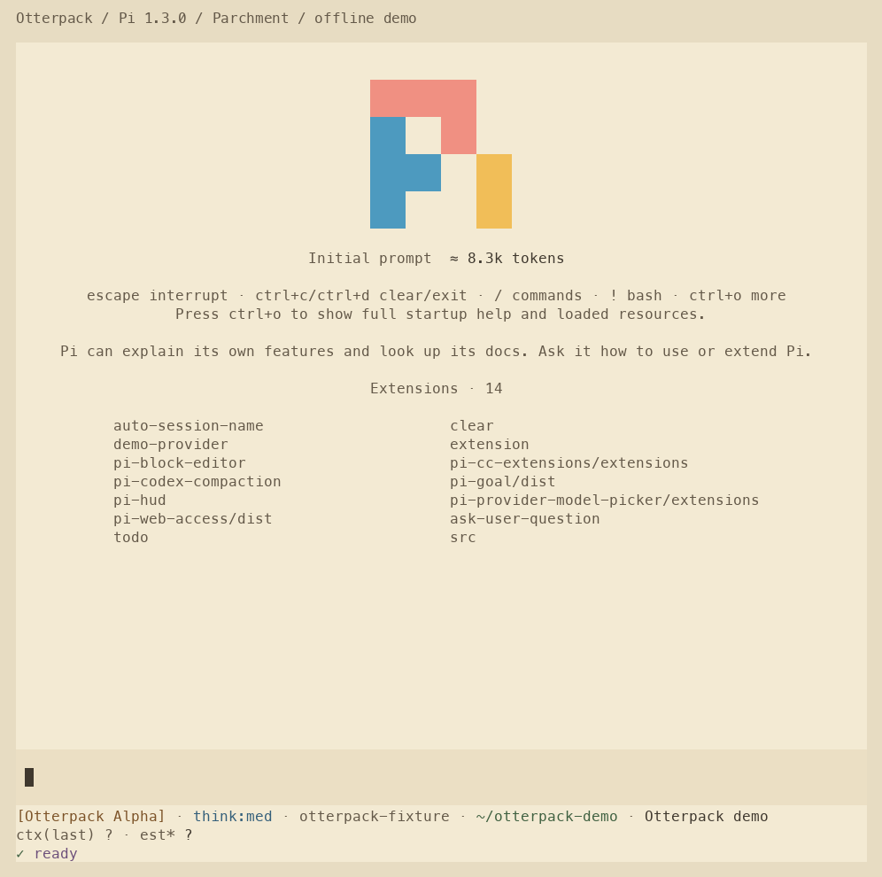

<p align="center"></p>

# Otterpack

**Make your tools comfortable. Keep your judgment.**

[简体中文](README.md) · [Catalogue](docs/catalogue.md) · [Compatibility & verification](docs/verification.md)

Otterpack is a personal collection of themes, plugins and practical habits for programming with AI. It brings together a parchment-colored terminal workspace, Herdr integrations, Pi extensions, mobile document reading, project-scoped skills and explicit task handoffs.

Independent tools keep their own repositories. This repository provides the theme files, configuration fragments, a pinned catalogue, and patches that capture selected unpublished improvements from the maintainer's everyday environment on **October 24, 2026**. The detailed guides are currently in Chinese.



## Start small

```sh
git clone https://github.com/M1racleShih/otterpack.git
cd otterpack
python3 scripts/verify.py
```

Python 3.11+ is needed for the offline verification helper. It checks formats, local links and checksums without installing anything.

- **Themes:** `themes/parchment/` covers Kitty, Herdr/Radar, Pi, Codex CLI, Claude Code and Kimi Code. `themes/catppuccin/` contains the existing Latte and Frappé Pi ports. See [theme instructions](docs/themes.md) before merging configuration.
- **Pi:** [pi-hud](https://github.com/M1racleShih/pi-hud), [pi-block-editor](https://github.com/M1racleShih/pi-block-editor), [pi-provider-model-picker](https://github.com/M1racleShih/pi-provider-model-picker), a small `/clear` extension and selected third-party packages. [cooking-pi](https://github.com/M1racleShih/cooking-pi) remains the full-recipe project.
- **Herdr:** [Radar](https://github.com/M1racleShih/herdr-radar) and [Remote](https://github.com/M1racleShih/herdr-remote-solution), with preserved upstream attribution.
- **Read anywhere:** [conv-docs](https://github.com/M1racleShih/conv-docs) serves explicitly shared documents to your phone. Remote access requires your own running service and reachable network.
- **Skills and handoffs:** [dynamic-skills](https://github.com/M1racleShih/dynamic-skills) and [cd-connect](https://github.com/M1racleShih/cd-connect).

To reconstruct a component in a new directory:

```sh
python3 scripts/materialize.py conv-docs /path/to/new-conv-docs-directory
```

The helper fetches a pinned GitHub commit, checks the local patch hash, applies it and verifies the changed files. It never installs packages, starts services or writes to existing destinations. The source remains available for inspection before you follow the component's own installation guide. See [snapshot details](docs/snapshots.md).

Linux is the tested platform. macOS and Windows support is documented per component without claiming tests that were not run. Screenshots use real interfaces with synthetic demonstration data; the Pi image is rendered from actual offline terminal output. See [image provenance](docs/screenshots.md).

The [mobile gallery](docs/herdr.md#在手机上看三件事) shows progress, code changes and conversation history in the actual Herdr Remote interface. Its terminal text and conversations are synthetic fixtures; they are not live agent runs. The updated captures use a consistent 390 × 700 browser viewport.

## Credits and license

Curated by [M1racleShih](https://github.com/M1racleShih). New Otterpack material is offered under [MIT](LICENSE), to the extent applicable. Components retain their own licenses and authors. In particular, **the Herdr Remote patch and its source remain AGPL-3.0-or-later**. See [THIRD_PARTY_NOTICES.md](THIRD_PARTY_NOTICES.md).

The mascot was created with an AI image-generation tool; [brand notes](docs/brand.md) record its prompt and provenance. This repository is unaffiliated with other projects called Otterpack.
