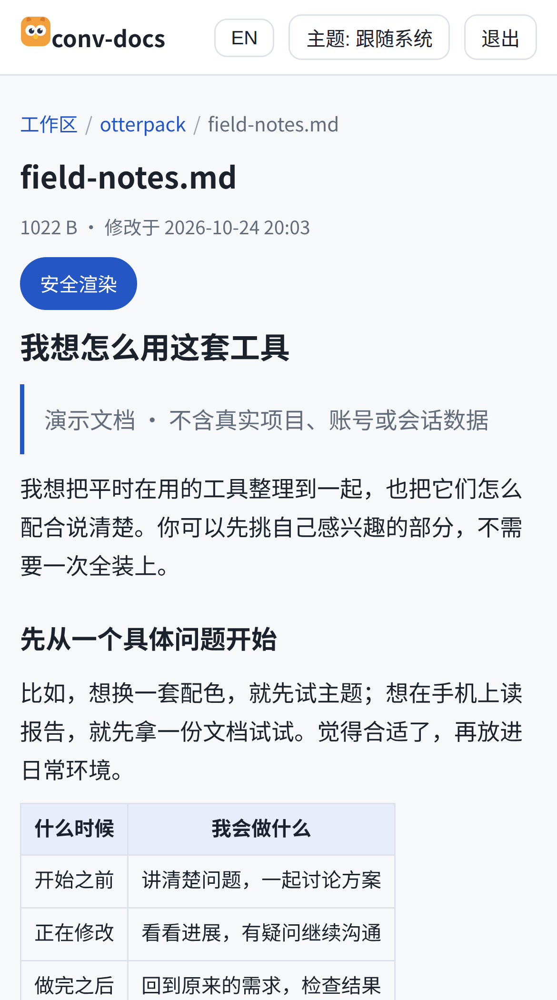
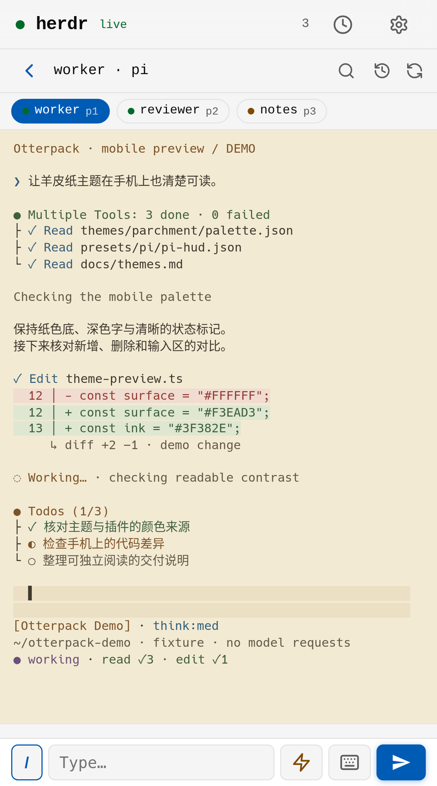
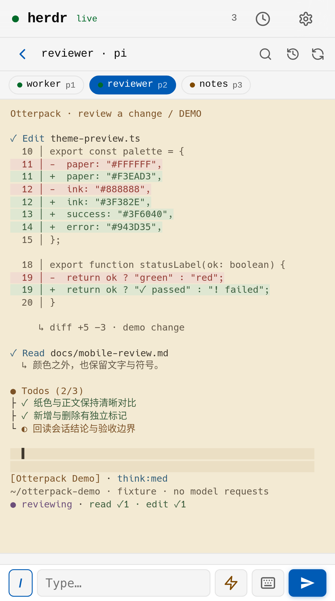
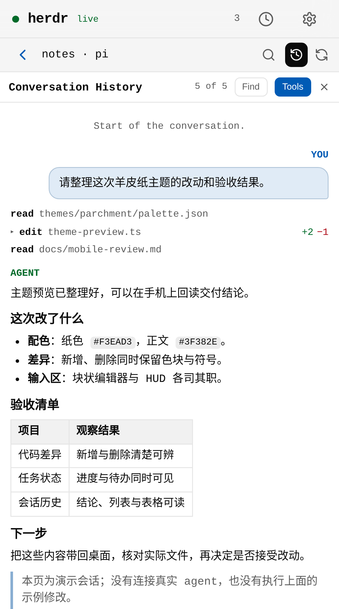

<p align="center"></p>

<h1 align="center">Otterpack · 小獭工具包</h1>

<p align="center"><strong>成为 AI 时代更好的 programmer。</strong></p>
<p align="center">我日常在用的主题、插件和工具，以及它们的使用方式。</p>
<p align="center"><a href="README.en.md">English</a> · <a href="docs/start.md">从哪里开始</a> · <a href="docs/catalogue.md">工具列表</a> · <a href="docs/workflows.md">我怎么用它们</a> · <a href="docs/verification.md">验证与兼容</a></p>

---

Hi，这里是 Otterpack，小獭工具包。

我想把自己平时在用的 Herdr 插件、Pi 插件、配色主题，还有 conv-docs 这些工具整理到一起，放到 GitHub 上分享。有些是我自己写的，有些是在开源项目上做的改造，也有直接拿来用的第三方工具。它们并非全部原创，但把这些东西组合起来，我觉得也很棒。

尤其是这套羊皮纸配色，我自己很喜欢，觉得它很漂亮，所以也想让大家看看。

这里会放主题文件、配置示例、工具版本和使用说明。独立工具继续在各自仓库维护，需要一起使用时，再来看这里怎么搭配。你可以只挑其中一两个试试。

## 先看看效果


*这张图来自 Pi 1.3.0 的真实离线终端输出，再由终端渲染器保存成图片。模型和任务内容是演示用的，没有调用上游服务。具体搭配见 [Pi 插件说明](docs/pi.md)。*

| 读一份完整的报告 | 看工具执行与任务进度 |
| --- | --- |
|  |  |

| 核对代码差异 | 回读会话结论 |
| --- | --- |
|  |  |

*手机端也一起放上来了。这几张是在 390 × 700 的浏览器视口里截的真实网页，里面的文档、终端内容和会话历史是演示数据，没有连接真实 agent。拍摄方式见[截图说明](docs/screenshots.md)，三个 Remote 场景见 [Herdr 使用说明](docs/herdr.md#在手机上看三件事)。*

## 目前收录了什么

| 分类 | 具体内容 | 使用说明 |
| --- | --- | --- |
| 配色主题 | 羊皮纸：Kitty、Herdr/Radar、Pi、Codex CLI、Claude Code、Kimi Code；另附 Catppuccin Latte / Frappé | [主题](docs/themes.md) |
| Herdr 插件 | Radar 侧栏状态、Remote 手机端，以及我做的一些改造 | [Herdr](docs/herdr.md) |
| Pi 插件 | HUD、块状输入框、供应商分组选择器、`/clear` 和其他扩展 | [Pi](docs/pi.md) |
| 文档预览 | conv-docs：指定文件预览、临时链接、手机阅读 | [conv-docs](docs/conv-docs.md) |
| Skill 管理 | dynamic-skills：共用技能池，按项目选择并固定版本 | [dynamic-skills](docs/skills-and-handoffs.md#dynamic-skills) |
| 任务交接 | cd-connect：把任务交给 DSH Desktop 执行，再检查结果 | [cd-connect](docs/skills-and-handoffs.md#cd-connect) |

我已经有一个 [cooking-pi](https://github.com/M1racleShih/cooking-pi) 项目了，不过我觉得并不冲突：cooking-pi 负责完整的 Pi 配置，这里把 Pi 和其他日常工具放在一起。还收录了早期项目[青鸟](https://github.com/M1racleShih/qingniao)，作为本地模型网关的参考。各项来源和许可都列在[工具列表](docs/catalogue.md)里。

## 想试一下的话

```sh
git clone https://github.com/M1racleShih/otterpack.git
cd otterpack
python3 scripts/verify.py
```

检查脚本需要 Python 3.11+，只读取资源文件。也可以从 [Releases](https://github.com/M1racleShih/otterpack/releases) 下载资源包。

如果你喜欢羊皮纸，可以先看[主题说明](docs/themes.md)。想得到包含我当前改动的完整工具源码，可以看[版本与补丁](docs/snapshots.md)。安装和账号配置仍按各工具自己的说明来，先选择你需要的部分就好。

首版整理的是 **2026-10-24** 的日常环境。目前实际验证的平台是 Linux，macOS 和 Windows 做到了哪一步、还有哪些没有测，都写在[验证记录](docs/verification.md)里。

## 为什么做这个项目

2026 年的 1024 程序员节，我向 AI 要了一份“礼物”：把这些正在用的工具整理成一个可以分享的项目，再配一个可爱、灵巧的 logo。于是就有了这只抱着工具袋的小水獭。

我希望这个项目能帮自己，也帮有相似需求的人，成为 AI 时代更好的 programmer。除了工具，我也想写清楚自己怎么和 AI 一起讨论问题、制定方案、检查结果。如果你对这些过程感兴趣，可以看看[我怎么用它们](docs/workflows.md)。

目前先整理成这样。后面有新的工具、改动或者使用感受，我会继续补充。你觉得哪些地方还可以调整，也欢迎一起讨论。

## 作者与许可

由 [M1racleShih](https://github.com/M1racleShih) 整理与维护。Otterpack 的新增代码、配置、文档和 logo 按 [MIT](LICENSE) 提供；已有组件保留自己的作者与许可，详见 [Third-party notices](THIRD_PARTY_NOTICES.md)。**Herdr Remote 的补丁与对应源码沿用 AGPL-3.0-or-later**，根目录的 MIT 不会改变它的许可。

Logo 使用 AI 图像工具生成，提示词和来源见[小獭 logo 说明](docs/brand.md)。这个名称只用于本仓库，与其他同名项目没有关联。

*1024 快乐 🦦*
