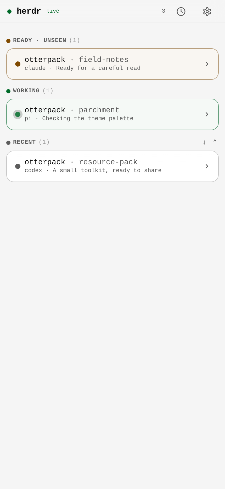

# Herdr：让工作状态看得见

[Herdr](https://github.com/herdrdev/herdr) 提供 workspace、tab 和 pane；[Radar](https://github.com/M1racleShih/herdr-radar) 帮我在侧栏看清 agent 的状态；[Remote](https://github.com/M1racleShih/herdr-remote-solution) 把可见性延伸到手机。

## 本包的组成

- Radar 固定到目录中的提交，保留其 MIT 作者署名。羊皮纸的 Agents／Spaces 模板放在[主题片段](../themes/parchment/herdr.toml)中。
- Remote 固定到公开基线，并附上当前的 transcript 兼容、羊皮纸终端背景和前端缓存修复。源码与补丁继续采用 AGPL-3.0-or-later。
- 宿主 Herdr、远程隧道、账号认证和插件启用由各自原生流程处理；这里没有会话快照或真实远程地址。

## 怎样接入

先按 [Herdr 官方文档](https://herdr.dev)安装宿主，再阅读固定版本的 Radar README。保持工作台运行时，只改展示配置并使用该版本的热加载入口。完成主题调整后，分别检查侧栏文字、pane 边框和终端底色。

Remote 可以先还原完整源码：

```sh
python3 scripts/materialize.py herdr-remote-solution ../otterpack-herdr-remote
```

随后阅读生成目录的 `DEPLOY_zh.md`，确认自己的网络与部署方式。它能远程交互和批准操作，权限范围与仅供阅读的 conv-docs 不同；启用前应理解项目的认证和访问边界。部署中的人工决策步骤仍由你决定。

## 我怎样使用状态



工作中表示有活动；等待回复表示需要我介入；完成表示可以开始检查结果。状态帮助我把注意力放到正确的位置，代码、文件和验证结果才是验收依据。

本包提供真实 Remote 网页的演示截图。当前制作会话没有连接到用户正在工作的 Herdr pane，因此不提供当前桌面会话截图；详见[图源说明](screenshots.md)。
